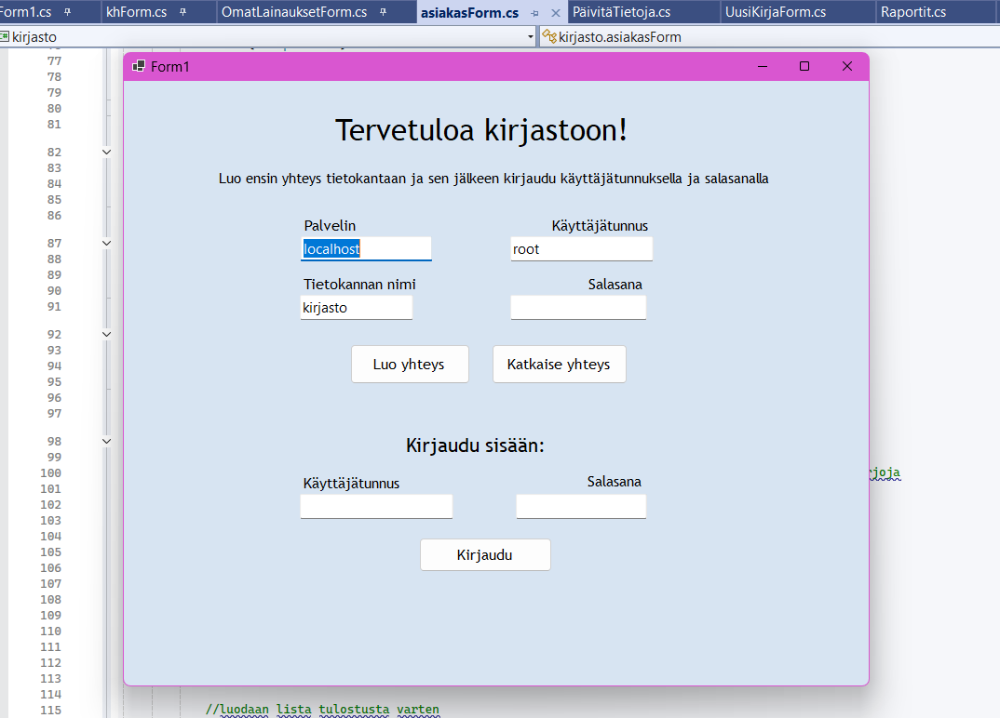
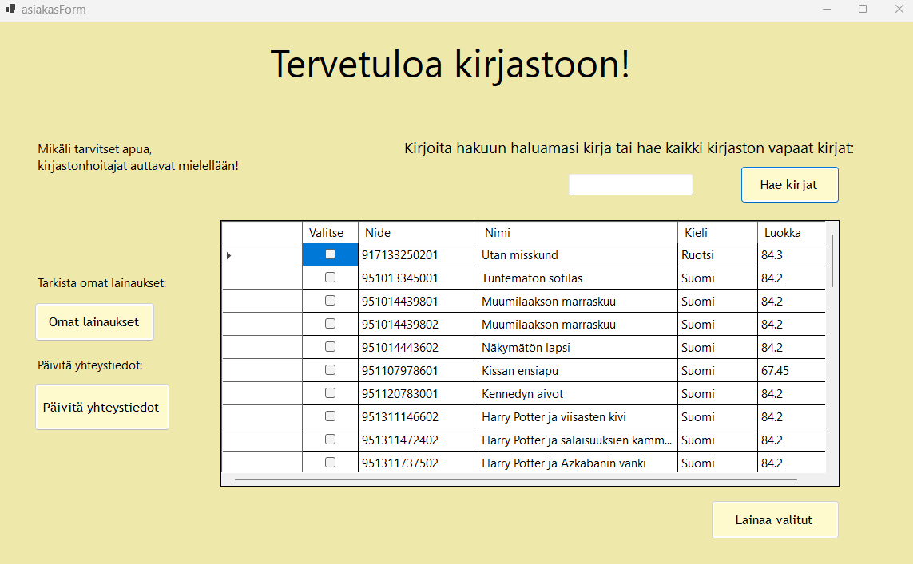
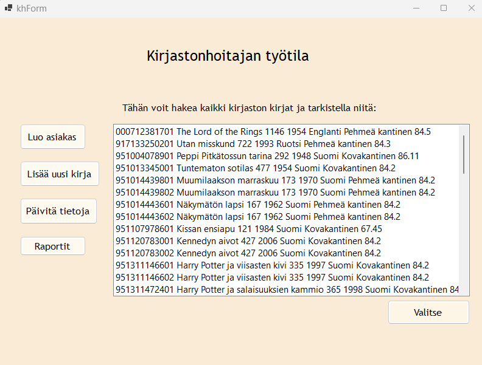

# Kirjastojärjestelmä (C# Windows Forms & MySQL)

C#-kielellä toteutettu työpöytäsovellus kirjaston aineiston, asiakkaiden ja lainausten hallintaan.

## Teknologiat
- C# / Windows Forms
- MySQL
- .NET Framework / .NET

## Ominaisuudet
- Tietokantayhteyden konfigurointi suoraan kirjautumisnäkymästä
- Roolipohjainen sisäänkirjautuminen (asiakas / henkilökunta)
- Kirjojen selaus, lainaus ja palautus
- Raportit ja tietojen päivitys

## Esivaatimukset
- Visual Studio (.NET Framework / .NET)
- MySQL-tietokantapalvelin (esim. XAMPP tai MySQL Workbench)

## Käyttöönotto ja testaus
1. Kloonaa repositorio koneellesi:
```bash
git clone https://github.com/iidapartanen-dev/kirjasto.git
```

## Kuvakaappaukset

### Aloitus- ja kirjautumisnäkymä


### Asiakasnäkymä


### Kirjastonhoitajan näkymä


Tuo tietokanta omaan MySQL-ympäristöösi:

-Käynnistä MySQL-palvelin (esim. XAMPP Control Panelista tai MySQL Workbenchista).

-Avaa tietokannan hallintatyökalu (esim. phpMyAdmin selaimessa osoitteessa http://localhost/phpmyadmin).

-Luo uusi tyhjä tietokanta nimellä kirjasto.

-Valitse luotu kirjasto-tietokanta, siirry välilehdelle Tuo (Import) ja valitse repositorion mukana tullut database_dump.sql-tiedosto. Tämä luo tarvittavat taulut ja testidatan.

Avaa kirjasto.sln Visual Studiossa ja käynnistä sovellus (F5).

Kirjaudu sovellukseen:

-Syötä aloitusnäkymään paikallisen tietokantasi tiedot (oletus: Palvelin localhost, Tietokanta kirjasto, Käyttäjätunnus root, Salasana tyhjä) ja paina Luo yhteys.

-Kirjaudu sisään testitunnuksilla (löydät valmiit tunnukset users.txt-tiedostosta tai voit rekisteröidä uuden asiakkaan).


